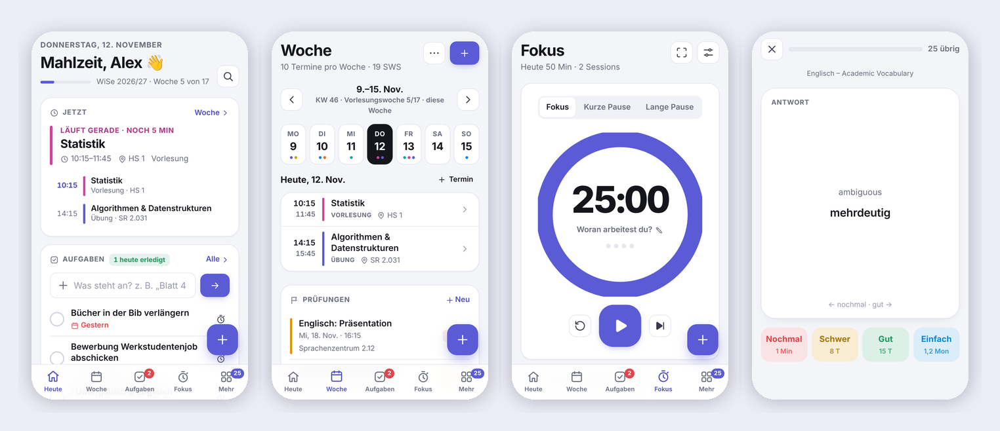
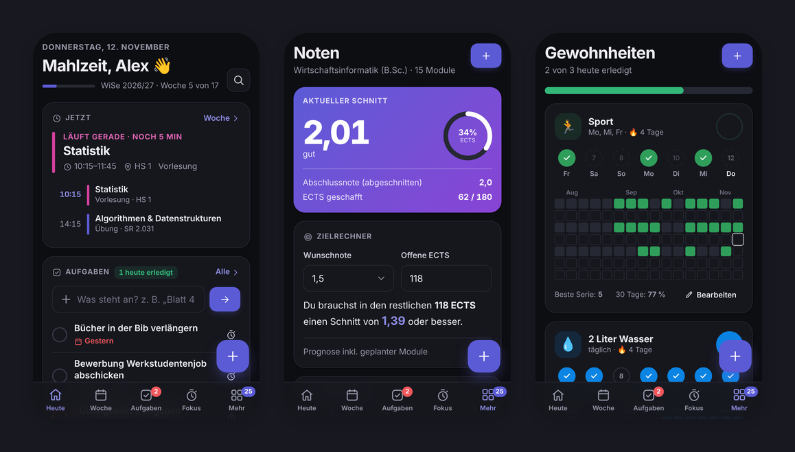
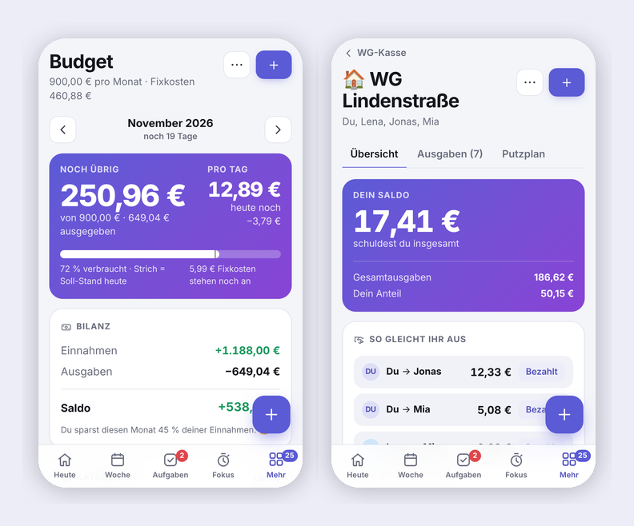
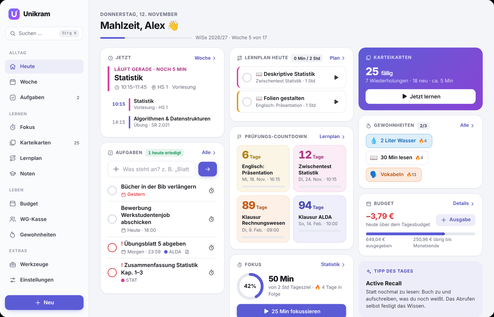
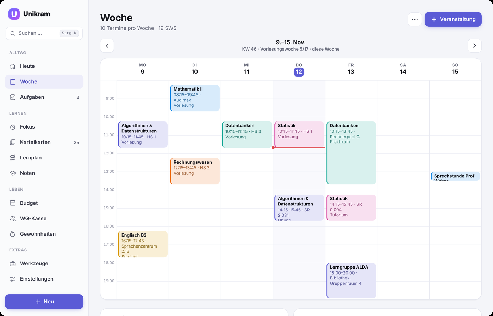
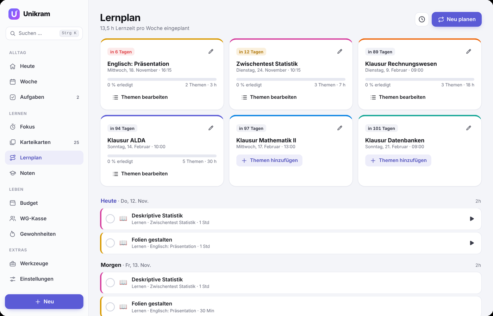

# Unikram 🎓

**Dein ganzer Unikram in einer App** – Stundenplan, Aufgaben, Fokus-Timer, Karteikarten, Noten, Budget, WG-Kasse, Lernplan und ein Werkzeugkasten für den Studi-Alltag. Läuft im Browser und offline, lässt sich wie eine echte App aufs Handy installieren und speichert alles **nur auf deinem Gerät**.



---

## Sofort loslegen

| Weg | Wofür | So geht’s |
|---|---|---|
| **GitHub Pages** | Täglich nutzen, aufs Handy installieren | Einmalig aktivieren (siehe unten), dann `https://pschaft.github.io/Zeig-mir-was-du-kannst/` öffnen |
| **Eine Datei** | Ohne Internet, ohne Server | [`dist/unikram.html`](dist/unikram.html) herunterladen und per Doppelklick öffnen |
| **Lokal** | Entwickeln | `python3 -m http.server 8080` → <http://localhost:8080> |

**GitHub Pages aktivieren (einmalig, 30 Sekunden):** Repository → *Settings* → *Pages* → bei *Source* „**GitHub Actions**“ wählen. Danach baut und veröffentlicht der Workflow die App bei jedem Push automatisch.

**Aufs Handy installieren:** Seite öffnen →
- **iPhone (Safari):** Teilen-Symbol → „Zum Home-Bildschirm“
- **Android (Chrome):** Menü ⋮ → „App installieren“

Beim ersten Start fragt Unikram nach deinem Namen und Semester. Mit **„Mit Beispieldaten erkunden“** bekommst du ein komplett gefülltes Semester zum Ausprobieren (in den Einstellungen jederzeit wieder löschbar).

---

## Was alles drin ist

### 📅 Alltag
- **Heute** – alles auf einen Blick: laufende/nächste Vorlesung mit Countdown, Tagesablauf, fällige Aufgaben, Prüfungs-Countdowns, Lernplan, Fokus-Ziel, fällige Karteikarten, Gewohnheiten, Tagesbudget und ein „Tipp des Tages“.
- **Woche** – Stundenplan als Raster (Desktop) oder Tagesliste (Handy), 14-tägige Termine (gerade/ungerade KW), Weihnachtspause & vorlesungsfreie Zeit, „Fällt heute aus“ per Tipp. **Import von `.ics`-Dateien** aus HISinOne, LSF, TUMonline, Stud.IP & Co. – erkennt Vorlesung/Übung/Tutorium, fasst Einzeltermine zu wöchentlichen Veranstaltungen zusammen und findet Klausuren automatisch. **Export** als Kalenderdatei für Google/Apple-Kalender.
- **Aufgaben mit Spracheingabe** – tipp einfach `Übungsblatt 4 #ana bis Freitag 10 Uhr !` und Unikram erkennt Datum, Uhrzeit, Kurs und Priorität (live als Vorschau). Versteht u. a. „morgen“, „übermorgen“, „nächsten Montag“, „in 2 Wochen“, „Ende der Woche“, „15.11.“, „3. Januar“, „um 14 Uhr“.

### 🧠 Lernen
- **Fokus-Timer** (Pomodoro) mit Ring-Animation, Zen-Modus, Tagesziel, Serien, Wochen-Diagramm, 16-Wochen-Heatmap und Auswertung nach Kurs. Läuft weiter, auch wenn du die Seite wechselst oder die App schließt.
- **Hintergrundgeräusche** – braunes/rosa/weißes Rauschen, Regen, Meereswellen und Kaminfeuer, **live im Browser synthetisiert** (keine Audiodateien, kein Streaming).
- **Karteikarten mit FSRS** – der moderne Spaced-Repetition-Algorithmus (FSRS‑4.5) zeigt jede Karte genau dann, wenn du sie fast vergessen hättest. Lernsession mit 3D-Flip, Tastatur (Leertaste, 1–4) und Wischgesten, Massenimport aus Quizlet/Anki/Excel (Tab, `;`, `-`, `=`), Export, „Pauken“-Modus vor der Klausur, Statistik und Fälligkeitsprognose.
- **Lernplan-Generator** – Themen pro Prüfung eintragen (z. B. `Kapitel 3; 4` = 4 Stunden), Lernzeit pro Wochentag festlegen → Unikram verteilt alles auf deine Tage, plant **Wiederholungen nach 1, 3 und 7 Tagen** und eine **Generalprobe am Vortag**. Wenn die Zeit knapp wird, bekommen kritische Prüfungen Vorrang; verpasste Blöcke werden mit „Neu planen“ umverteilt.
- **Noten** – ECTS-gewichteter Schnitt, Abschlussnote (abschneiden oder runden), ECTS-Fortschritt, Notenverteilung, Schnitt pro Semester, Prognose mit geplanten Modulen und der **Zielrechner**: „Welchen Schnitt brauche ich in den restlichen ECTS für eine 1,5?“

### 💸 Leben
- **Budget** – Monatsbudget, **Tagesbudget** („heute noch 12,40 € drin“), Kategorien mit Limits, Donut-Diagramm, 6-Monats-Trend, Einnahmen & Saldo. **Fixkosten** (Miete, Handy, Spotify, BAföG …) werden automatisch jeden Monat gebucht. CSV-Export für Excel.
- **WG-Kasse** – gemeinsame Ausgaben fair aufteilen (gleichmäßig oder genaue Beträge), Salden, **Ausgleich mit möglichst wenigen Überweisungen**, Zahlungen erfassen, **Putzplan mit wöchentlicher Rotation**. Teilen per Link – ganz ohne Server oder Account.
- **Gewohnheiten** – Routinen mit Wochentagen, Serien 🔥, Erfüllungsquote, Heatmap und rückwirkendem Abhaken.

### 🧰 Werkzeuge
- **Wortzähler** – Wörter, Zeichen (mit/ohne Leerzeichen), Normseiten, Lese- & Sprechzeit, Zielwert, häufigste Wörter und **Füllwort-Check** für Hausarbeiten.
- **Quellen zitieren** – APA 7, Harvard (dt.), IEEE, MLA 9 und deutsche Zitierweise; **Daten per DOI oder ISBN abrufen** (Crossref, Open Library, Google Books); Literaturverzeichnis, das beim Einfügen in Word die Kursivschrift behält.
- **Notenschlüssel** – Punkte → Note, kompletter Notenspiegel, „wie viele Punkte fehlen zur nächsten Note?“ und die **bayerische Formel** für Auslandsnoten.
- **Vortrags-Timer** – riesiger Countdown fürs Referat, wird gelb und rot, Vollbild.
- **Glücksrad** – „Mensa oder Döner?“ – mit Animation und Konfetti.
- **Gruppen-Generator** und **Atemübung** (Box Breathing, 4‑7‑8) gegen Prüfungsstress.

### ✨ Und sonst
- **Suche & Befehle** mit <kbd>Strg</kbd>/<kbd>⌘</kbd>+<kbd>K</kbd> über alles: Seiten, Aufgaben, Kurse, Karten, Prüfungen – oder direkt „Blatt 5 morgen“ als neue Aufgabe anlegen.
- Hell/Dunkel/System, 8 Akzentfarben, Konfetti für Erfolgsmomente, Rückgängig nach dem Löschen, Tastenkürzel, Erinnerungen (Benachrichtigungen), Backup als JSON.

<p align="center">
  
  
</p>



<details>
<summary>Weitere Desktop-Ansichten (Woche, Lernplan)</summary>



</details>

---

## Datenschutz

- **Keine Anmeldung, kein Tracking, keine Cloud.** Alle Daten liegen im `localStorage` deines Browsers.
- Netzwerkanfragen gibt es nur, wenn du sie auslöst: DOI-/ISBN-Abruf beim Zitieren.
- **Backup:** Einstellungen → „Backup exportieren“ (JSON). So ziehst du auch auf ein neues Gerät um.
- Hinweis: Wenn du die Browserdaten löschst, ist alles weg – also ab und zu ein Backup machen (Unikram erinnert dich daran).

## Tastenkürzel

| Taste | Aktion | Taste | Aktion |
|---|---|---|---|
| <kbd>Strg</kbd>+<kbd>K</kbd> / <kbd>/</kbd> | Suche & Befehle | <kbd>Leertaste</kbd> | Fokus: Start/Pause · Karte umdrehen |
| <kbd>N</kbd> | Neue Aufgabe | <kbd>1</kbd>–<kbd>4</kbd> | Karte bewerten |
| <kbd>A</kbd> | Neue Ausgabe | <kbd>R</kbd> / <kbd>S</kbd> / <kbd>Z</kbd> | Fokus: Reset / Überspringen / Zen |
| <kbd>H</kbd> <kbd>W</kbd> <kbd>T</kbd> <kbd>F</kbd> <kbd>L</kbd> | Heute, Woche, Aufgaben, Fokus, Lernen | <kbd>?</kbd> | Alle Kürzel |

---

## Für Entwickler:innen

**Keine Laufzeit-Abhängigkeiten, kein Build nötig:** reines HTML/CSS/JavaScript mit ES-Modulen. Der Browser lädt `index.html` direkt.

```
index.html            App-Shell
css/app.css           Design-System (Tokens, hell/dunkel, mobil zuerst)
js/app.js             Einstieg: Router, Navigation, Event-Delegation, Tastenkürzel
js/core/              html-Templating mit Auto-Escaping, DOM-Morphing, Store, Dialoge/Formulare,
                      Diagramme, Audio-Synthese, Konfetti, Datums- & Geldformatierung
js/logic/             Reine Logik (ohne DOM, mit Tests): Spracheingabe, FSRS, Noten, Budget,
                      WG-Ausgleich, Lernplan, ICS, Zitieren, Gewohnheiten, Demo-Daten, Sync-Format
js/views/             Seiten (je Modul eine Datei, inkl. Formulare) + views/tools/ für Werkzeuge
js/services/          Timer, Erinnerungen, Benachrichtigungen, Dateien, Synchronisation
sw.js                 Service Worker (generiert) für Offline-Betrieb
scripts/              Build: Service Worker, Ein-Datei-Version, Icons
tests/                Unit-Tests (node --test) + End-to-End-Tests (Playwright)
```

**Ein paar technische Details, die Spaß gemacht haben:**
- **Rendering** über `html`‑Tagged-Templates, die alles automatisch escapen, plus ein kleiner **DOM-Morph** (à la morphdom): ganze Seiten werden neu gerendert, ohne Fokus, Scrollposition oder Eingaben zu verlieren.
- **FSRS‑4.5** mit Abrufwahrscheinlichkeit `R(t,S) = (1 + 19/81 · t/S)^−0,5`, Stabilitäts- und Schwierigkeitsmodell und Kurzzeit-Lernschritten.
- **Lernplan**: Tagesweise Zuteilung nach Dringlichkeit (Reststoff ÷ verbleibende Kapazität), mit Vorrang für zeitkritische Prüfungen, verteilten Wiederholungen und Generalprobe.
- **WG-Ausgleich**: Greedy-Matching größter Schuldner ↔ größter Gläubiger, Cent-genau mit fair rotierten Rundungscents.
- **Rauschen**: Pink-Noise-Filter nach Paul Kellet, Brown Noise per Integration, Regen/Kamin aus gefilterten Impuls-Bursts – mit nahtloser Schleife durch Überblendung.

### Befehle

```bash
npm test                 # 45 Unit-Tests (Node ≥ 20)
npm run build            # Service Worker + dist/unikram.html (braucht: npm install)
npm run test:e2e         # Browser-Tests, Server auf :8080 nötig (braucht Playwright)
```

Nach Änderungen an App-Dateien `npm run build` ausführen – dann bekommt der Service Worker eine neue Version und installierte Apps aktualisieren sich („Neue Version verfügbar“). Die CI prüft das automatisch.
